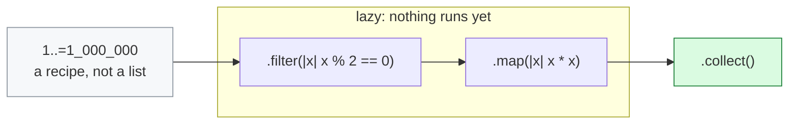
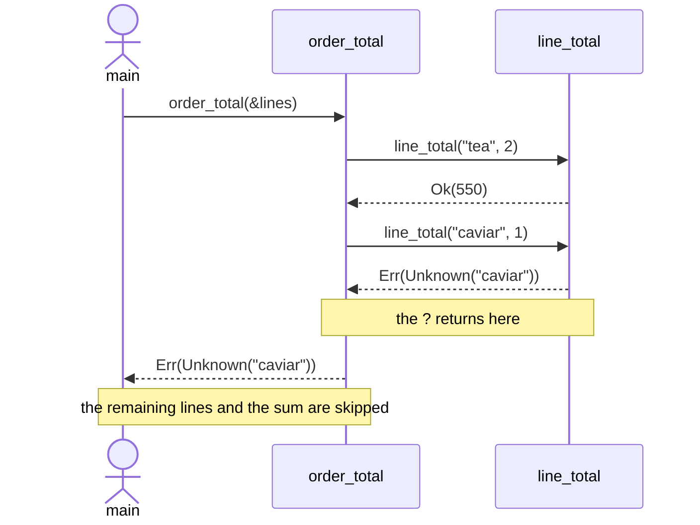

# Flow diagrams

Two of the course's abstract concepts are *sequences* rather than structures — a data
flow, and control leaving a function early. Both are Mermaid, so they follow the
reader's theme, stay readable as text in a diff, and cannot go stale the way a bitmap
does. The other four diagrams are SVG files beside this one, because they depend on
precise placement Mermaid cannot express.

One limitation worth knowing: Mermaid's label parser strips angle brackets, so
`.collect::<Vec<_>>()` is written `.collect()` here and the type is named in the prose.
The lesson itself (`src/section_09_iterators.rs`) carries the full form.

## Iterator laziness

Stages describe work. Nothing runs until a consuming stage asks for a value — which is
also why `(1u64..).map(...).take(5)` terminates and `(1u64..).collect()` does not.

Consumers that run the chain: `.collect()`, `.sum()`, `.count()`, `.max()`,
`.for_each(..)`, `.take(n)` when followed by any of them.

## `?` propagation

`?` does not handle the error. It returns it to the caller, one frame at a time, and
every frame it passes through abandons the rest of its body — the remaining order lines,
and the sum after `collect`.

The same shape appears in section 14's URL parser, where five `?`s in a row are what
make `parse_url` read as one sentence rather than a nest of `if let`.
